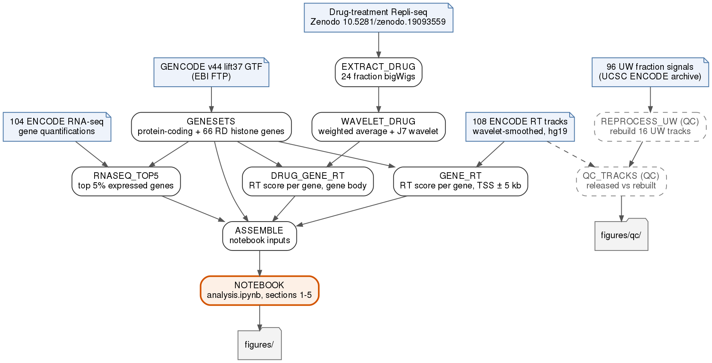

# hlb-rt-paper

Replication timing of the replication-dependent histone genes: 50 ENCODE cell lines (hg19) and a drug-treatment Repli-seq study.



## Run

Requirements: [Nextflow](https://www.nextflow.io) ≥ 24.10, [uv](https://docs.astral.sh/uv/), `curl`, `unzip` and internet access.

```bash
uv sync                                   # pinned Python environment in .venv
mkdir run && cd run
nextflow run ../pipeline/main.nf -profile local
```

The pipeline downloads all inputs from public sources, then executes the notebook.
For a Slurm cluster, other options and the full methods, see [METHODS.md](METHODS.md).

## Analysis

[`analysis.ipynb`](analysis.ipynb) holds the analysis and its plots. To open the notebook interactively, set `RT_DATA=run/results/notebook_inputs` (the pipeline run's `results/notebook_inputs`). The figures and their plotted values are in [`figures/`](figures/).
